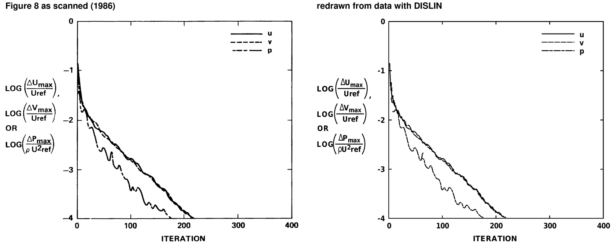

# CNS3D

CNS3D solves the three-dimensional incompressible Navier-Stokes equations, laminar or with the
k-epsilon model, in nonorthogonal body-fitted coordinates by the SIMPLE-C method. It was written by
Y. S. Chen and published as a FORTRAN listing in a 1986 NASA report. This repository holds the program
read card by card from the scanned listing, a version with the problems of the listing corrected, the
report as text, its test cases rerun, and its figures redrawn.

Chen, Y. S. (1986). [A computer code for three-dimensional incompressible flows using nonorthogonal
body-fitted coordinate systems](https://ntrs.nasa.gov/citations/19860017072) (No. NASA-CR-178818).

## Run

The listing is set up for the report's case D, laminar flow in a 90-deg bend. Build the program, make
the grid and the restart file (unit 8), run with the control cards (unit 5), and print the velocity
profiles of the report's Figure 19:

    gfortran -std=legacy -fno-automatic -o cns3d cns3d.f
    python3 test/bend.py && gfortran -std=legacy -o restart test/restart.f && ./restart
    ./cns3d < test/bend.5 > out6 && python3 test/profiles.py fort.7

It converges in 210 iterations. [TESTS](TESTS) gives the inputs and the edits for the other cases,
made by `test/case.py`.

## Files

- [report.pdf](report.pdf), [code.pdf](code.pdf): the scanned report and its Appendix C program listing
- [report.md](report.md), [fig/](fig): the report as text (pages 1 to 50 of report.pdf), with equations in LaTeX and the figures cropped from the scan
- [cns3d.f](cns3d.f): the program as printed in the listing, one card per line
- [cns3d_fixed.f](cns3d_fixed.f): cns3d.f with the problems of the listing corrected (CHANGES, section 5; TESTS, notes 1 to 6)
- [CHANGES](CHANGES): how the listing was read, the cards read by hand, the check with the original compiler, and the corrections
- [TESTS](TESTS): how to run the program, the report's test cases rerun, and notes on the program as printed
- [test/](test): inputs and scripts for TESTS
- [cuda/](cuda/README.md): two GPU programs, for three- and two-dimensional cases, many at once
- [redraw/](redraw/README.md): the report's figures as data and DISLIN programs that redraw them, matched to the scan; [gallery](redraw/GALLERY.md) of every figure, the redraw laid over the scan

## Licence

The work added here is under the MIT licence ([LICENSE](LICENSE)); the report and the program as
printed are NASA Contractor Report CR-178818, distributed by NASA as Unclassified-Unlimited.
