<!-- NASA CR-178818 (Chen 1986), pages 1 to 50 of report.pdf; Appendix C, the program listing, is cns3d.f.
Text read with chandra-ocr-2 and checked against two other readings (olmOCR-2, Tesseract): every word placed on the
scan and the disputed ones rendered from the scan's own glyphs and fitted to their boxes; equations and table math
compared with the scan by eye. Anchors pN are PDF pages. Figures are crops of the scan. Misprints are kept and
marked 'as printed'. -->

<a id="p1"></a> 

NASA CONTRACTOR REPORT

NASA CR-178818

# A COMPUTER CODE FOR THREE-DIMENSIONAL INCOMPRESSIBLE FLOWS USING NONORTHOGONAL BODY-FITTED COORDINATE SYSTEMS

By Y. S. Chen  
Universities Space Research Association  
Science and Engineering Directorate  
Atmospheric Sciences Division  
Systems Dynamics Laboratory

Final Report

March 1986

(NASA-CR-178818) A COMPUTER CODE FOR  
THREE-DIMENSIONAL INCOMPRESSIBLE FLOWS USING  
NONORTHOGONAL BODY-FITTED COORDINATE SYSTEMS  
Final Report (Universities Space Research  
Association) 86 p HC A05/MF A01 CSCL 20D G3/34

N86-26544

Unclas  
42915

Prepared for  
NASA-Marshall Space Flight Center  
Marshall Space Flight Center, Alabama 35812

<a id="p2"></a>

<a id="p3"></a>

<table border="1">
<tr>
<td colspan="2">1. REPORT NO.<br/>NASA CR-178818</td>
<td colspan="2">2. GOVERNMENT ACCESSION NO.</td>
<td colspan="2">3. RECIPIENT'S CATALOG NO.</td>
</tr>
<tr>
<td colspan="3" rowspan="2">4. TITLE AND SUBTITLE<br/>A Computer Code for Three-Dimensional Incompressible Flows Using Nonorthogonal Body-Fitted Coordinate Systems</td>
<td colspan="3">5. REPORT DATE<br/>March 1986</td>
</tr>
<tr>
<td colspan="3">6. PERFORMING ORGANIZATION CODE</td>
</tr>
<tr>
<td colspan="2">7. AUTHOR(S)<br/>*Y. S. Chen</td>
<td colspan="4">8. PERFORMING ORGANIZATION REPORT #</td>
</tr>
<tr>
<td colspan="3" rowspan="3">9. PERFORMING ORGANIZATION NAME AND ADDRESS<br/><br/>George C. Marshall Space Flight Center<br/>Marshall Space Flight Center, Alabama 35812</td>
<td colspan="3">10. WORK UNIT NO.</td>
</tr>
<tr>
<td colspan="3">11. CONTRACT OR GRANT NO.<br/>NAS8-35918</td>
</tr>
<tr>
<td colspan="3">13. TYPE OF REPORT &amp; PERIOD COVERED<br/>Final<br/>Contractor Report</td>
</tr>
<tr>
<td colspan="3">12. SPONSORING AGENCY NAME AND ADDRESS<br/><br/>National Aeronautics and Space Administration<br/>Washington, D.C. 20546</td>
<td colspan="3">14. SPONSORING AGENCY CODE</td>
</tr>
<tr>
<td colspan="6">15. SUPPLEMENTARY NOTES *Universities Space Research Association<br/><br/>Prepared by Atmospheric Sciences Division, Systems Dynamics Laboratory, Science and Engineering Directorate.</td>
</tr>
<tr>
<td colspan="6">16. ABSTRACT<br/><br/><p>In this report, a numerical method for solving the equations of motion of three-dimensional incompressible flows in nonorthogonal body-fitted coordinate (BFC) systems has been developed. The equations of motion are transformed to a generalized curvilinear coordinate system from which the transformed equations are discretized using finite difference approximations in the transformed domain. The hybrid scheme is used to approximate the convection terms in the governing equations. Solutions of the finite difference equations are obtained iteratively by using a pressure-velocity correction algorithm (SIMPLE-C). Numerical examples of two- and three-dimensional, laminar and turbulent flow problems are employed to evaluate the accuracy and efficiency of the present computer code. The user's guide and computer program listing of the present code are also included.</p></td>
</tr>
<tr>
<td colspan="3">17. KEY WORDS<br/>Navier-Stokes Solver<br/>Incompressible<br/>Curvilinear Coordinate<br/>Computer Code</td>
<td colspan="3">18. DISTRIBUTION STATEMENT<br/><br/>Unclassified-Unlimited</td>
</tr>
<tr>
<td colspan="2">19. SECURITY CLASSIF. (of this report)<br/><br/>Unclassified</td>
<td colspan="2">20. SECURITY CLASSIF. (of this page)<br/><br/>Unclassified</td>
<td colspan="2">21. NO. OF PAGES<br/>87</td>
</tr>
<tr>
<td colspan="2"></td>
<td colspan="2"></td>
<td colspan="2">22. PRICE<br/>NTIS</td>
</tr>
</table>

<a id="p4"></a>

<a id="p5"></a> <!-- printed page iii -->

**TABLE OF CONTENTS**

|  | Page |
|---|---|
| INTRODUCTION ..... | 1 |
| TRANSFORMATION OF THE EQUATIONS OF MOTION ..... | 2 |
| DISCRETIZATION OF THE EQUATIONS OF MOTION ..... | 5 |
| SOLUTION PROCEDURES ..... | 7 |
| NUMERICAL EXAMPLES ..... | 12 |
| A. 2-D Laminar Driven Square-Cavity Flows ..... | 12 |
| B. 2-D Laminar Flows Over a Backward-Facing Step ..... | 15 |
| C. 2-D Turbulent Flows Over a Backward-Facing Step ..... | 18 |
| D. Developing Laminar Flow Inside a 90-Deg-Bend Square Duct ..... | 18 |
| CONCLUSIONS ..... | 23 |
| REFERENCES ..... | 24 |
| APPENDIX A. COMPUTER CODE STRUCTURES AND USER'S GUIDE ..... | 27 |
| APPENDIX B. LIST OF FORTRAN SYMBOLS ..... | 31 |
| APPENDIX C. PROGRAM LISTING ..... | 41 |

**PRECEDING PAGE BLANK NOT FILMED**

<a id="p6"></a> <!-- printed page iv -->

## LIST OF ILLUSTRATIONS

| Figure | Title | Page |
|---|---|---|
| 1. | Three-dimensional grid structure and labeling around a grid node P ..... | 6 |
| 2. | Locations where the variables are stored..... | 8 |
| 3. | Control volumes where the mass conservation is evaluated for solving the pressure correction equation ..... | 11 |
| 4. | Physical geometry and wall boundary conditions for laminar flows inside a wall-driven square cavity ..... | 12 |
| 5. | Mesh systems used for driven cavity problem ..... | 13 |
| 6. | Velocity vector plots ..... | 14 |
| 7. | Comparisons of velocity profiles along the mid-section of the square cavity ..... | 14 |
| 8. | Convergence history for the driven cavity problem, $Re = 400$ ..... | 15 |
| 9. | Physical geometry and boundary conditions of laminar flows over a backward-facing step..... | 16 |
| 10. | Reattachment length versus Reynolds number for laminar flows over a backward-facing step ..... | 17 |
| 11. | Streamline plots for laminar flow over a backward-facing step..... | 17 |
| 12. | Physical geometry and boundary conditions of turbulent flows over a backward-facing step..... | 18 |
| 13. | Locus of flow reversal inside the recirculation region for turbulent flow over a backward-facing step..... | 19 |
| 14. | Stream line pattern of turbulent flow over a backward-facing step with 2:3 expansion ratio..... | 19 |
| 15. | Contours of turbulent kinetic energy of turbulent flow over a backward-facing step with 2:3 expansion ratio ..... | 19 |
| 16. | Geometry and mesh system of a 90-deg-bend square duct developing laminar flow problem ..... | 20 |
| 17. | Primary velocity patterns of laminar flow inside a 90-deg-bend square duct ..... | 21 |
| 18. | Secondary velocity patterns of laminar flow inside a 90-deg-bend ... | 22 |
| 19. | Primary velocity profiles for a 3-D 90-deg-bend square duct..... | 23 |

<a id="p7"></a> <!-- printed page v -->

## NOMENCLATURE

| Symbol | Definition |
|---|---|
| A | link coefficient of finite difference equation |
| $A_p$ | link coefficient of the node at the center of a control volume |
| $A^u$ | link coefficient for the u-equation |
| $A^v$ | link coefficient for the v-equation |
| $A^w$ | link coefficient for the w-equation |
| $A^o$ | link coefficient for time marching scheme |
| $C_v$ | specific heat constant at constant volume |
| $C_1$ | turbulence model constant, = 1.44 |
| $C_2$ | turbulence model constant, = 1.92 |
| $C_\mu$ | turbulence model constant, = 0.09 |
| D | diffusion coefficient for the pressure correction equation |
| e | internal energy per unit mass (jour/kg) |
| J | Jacobian of the metric transformation |
| k | turbulence kinetic energy ($`m^2/S^2`$) |
| k' | thermal conductivity of the fluid |
| P | pressure in the fluid ($`N/m^2`$) |
| $P_r$ | production term for the turbulent kinetic energy |
| Q | energy added per unit volume (jour/$`m^3`$) |
| S | source term |
| $S_u$ | source term of the u-equation |
| $S_v$ | source term of the v-equation |
| $S_w$ | source term of the w-equation |
| T | temperature ($`^\circ K`$) |
| t | time (sec) |
| u | velocity in x direction |
| $v$ | velocity in y direction |
| $w$ | velocity in z direction |
| $X$ | X-coordinate (m) |
| $Y$ | Y-coordinate (m) |
| $Z$ | Z-coordinate (m) |

<a id="p8"></a> <!-- printed page vi -->

### Greek

|  |  |
|---|---|
| $\Gamma$ | diffusion coefficient |
| $\epsilon$ | turbulent kinetic energy dissipation rate ($`m^2/s^3`$) |
| $\Delta$ | difference operator |
| $\phi$ | variable of general transport equation |
| $\phi^o$ | solution at the previous time level |
| $\sigma_k$ | turbulence model constant, = 1.0 |
| $\sigma_\epsilon$ | turbulence model constant, = 1.3 |
| $\xi$ | curvilinear coordinate |
| $\zeta$ | curvilinear coordinate |
| $\mu$ | molecular viscosity (N-S/m$`^2`$) |
| $\mu_t$ | turbulent eddy viscosity (N-S/m$`^2`$) |
| $\mu_{eff}$ | effective viscosity (N-S/m$`^2`$) |
| $\rho$ | density (kg/m$`^3`$) |
| $\sum_i$ | summation over all values around a grid node P |
| $\eta$ | curvilinear coordinate |

### Subscript

|  |  |
|---|---|
| $i$ | index of all possible values |
| ref | reference value |
| max | maximum quantity |

<a id="p9"></a> <!-- printed page vii -->

### Superscript

- o previous time level solution
- \* current solution
- ' correction quantity

<a id="p10"></a>

<a id="p11"></a>

CONTRACTOR REPORT

A COMPUTER CODE FOR THREE-DIMENSIONAL INCOMPRESSIBLE FLOWS USING NONORTHOGONAL BODY-FITTED COORDINATE SYSTEMS

## INTRODUCTION

With the currently increasing computer capability and various flow solvers developed, numerical simulations of three-dimensional incompressible flow problems using Reynolds-average Navier-Stokes equations are now becoming more feasible in many engineering design and analysis applications. In many real world flow problems, the boundary geometries are complex such that it is more accurate to describe the geometries using body-fitted coordinate (BFC) systems. Especially for internal flow problems with complex geometries such as those of the hot gas manifold (HGM) of the Space Shuttle Main Engine (SSME), the use of nonorthogonal BFC systems for numerical solutions can be beneficial in many aspects. It is not only the boundary geometries that can be represented more closely using BFC systems, but also grid-refined solutions can be obtained without increasing an excessive amount in computer memory. In addition, once a particular flow problem has been set up, the redesign or optimization process of the boundary shapes can be performed very easily using BFC systems.

Several numerical methods [1,2,3,4,5,6] has been developed for solving the incompressible Navier-Stokes equations in 3-D BFC systems. The main difference between these methods lies in the way of finding a pressure field such that the flowfield can be as close to divergence-free as possible (i.e. to satisfy the mass conservation equation). This is the main feature and difficulty of solving the incompressible flow problems. Numerical methods of References 1, 2 and 3, for instance, have employed the pseudocompressibility approach and time-iterative scheme to generate the pressure field so that the continuity equation is satisfied when a steady state solution is reached. In these methods, artificial smoothing techniques must be used to obtain a strong coupling between the velocity and pressure fields. Methods of References 4, 5 and 6, on the other hand, have utilized a successive pressure-velocity correction scheme by using a Poisson's equation for pressure correction derived approximately form the continuity and momentum equations. <!-- as printed: form for from --> For these latter methods, grid staggering between the velocity vectors and the pressure nodes must be used to ensure stability of the numerical solutions.

There are several possible methods of grid staggering associated with different features in solving the pressure correction equation. These grid staggering methods were discussed in Reference 6, from which one of the methods was shown to be the most promising arrangement (i.e. with the velocity vectors located at the faces of a volume which contains the pressure and other scalars at its center). But, this method has one drawback, that the velocity components are solved using different control volumes. It is for this reason that a grid staggering system similar to the one used by Vanka et al. [4] is developed in the present study. The present method of grid staggering and pressure correction equation that was described by Vanka [4] and Maliska [6]. Also, using the present method, the same control volume is used for the velocity components and scalar quantities.

<a id="p12"></a> <!-- printed page 2 -->

In the following sections, basic elements for establishing the present computer code for solving the curvilinear Navier-Stokes equations in three-dimensional space (CNS3D) will be described. These are followed by a series of standard numerical examples used to evaluate the accuracy and efficiency of the present numerical method. The numerical examples include laminar flow driven-cavity problem, cases of laminar and turbulent flows over backward-facing steps, and 3-D laminar flows inside a 90-deg-bend square duct. Applications of the present code to the internal flow problems of SSME will be included in future publications.

A user's guide to the present CNS3D code is provided in Appendix A. Appendix B contains a list and definitions of all the major fortran symbols used in the computer program which is listed in Appendix C.

## TRANSFORMATION OF THE EQUATIONS OF MOTION

For incompressible Newtonian fluid, the continuity, momentum and energy equations can be written as:

```math
U_t + E_x + F_y + G_z = S \qquad (1)
```

where $(x,y,z)$ represent the Cartesian coordinates, and

```math
U = \begin{Bmatrix} \rho \\ \rho u \\ \rho v \\ \rho w \\ \rho e - Q \end{Bmatrix} \quad E = \begin{Bmatrix} \rho u \\ \rho uu - \mu u_x \\ \rho uv - \mu v_x \\ \rho uw - \mu w_x \\ \rho ue - k' T_x \end{Bmatrix}
```

```math
F = \begin{Bmatrix} \rho v \\ \rho vu - \mu u_y \\ \rho vu - \mu v_y \\ \rho vw - \mu w_y \\ \rho ve - k' T_y \end{Bmatrix} \quad G = \begin{Bmatrix} \rho w \\ \rho wu - \mu u_z \\ \rho wv - \mu w_z \\ \rho ww - \mu w_z \\ \rho we - k' T_z \end{Bmatrix}
```

<!-- as printed: third rows of F and G read rho vu - mu v_y and rho wv - mu w_z; the pattern of E and the momentum equations gives rho vv - mu v_y and rho wv - mu v_z -->

<a id="p13"></a> <!-- printed page 3 -->

```math
S = \left\{ \begin{array}{l} 0 \\ (\mu u_x)_x + (\mu v_x)_y + (\mu w_x)_z - P_x \\ (\mu u_y)_x + (\mu v_y)_y + (\mu w_y)_z - P_y \\ (\mu u_z)_x + (\mu v_z)_y + (\mu w_z)_z - P_z \\ \mu [2(u_x^2 + v_y^2 + w_z^2) + (v_x + u_y)^2 + (w_y + v_z)^2 + (u_z + w_x)^2 \\ \quad - \frac{2}{3} (u_x + v_y + w_z)^2] \end{array} \right\}
```

$e$ = the internal energy per unit mass = $C_v T$ for perfect gas

$Q$ = energy added per unit volume

$k'$ = thermal conductivity of the fluid .

Equation (1) is transformed to a general curvilinear coordinate system $(\xi, \eta, \zeta)$, which results in equation (2).

```math
\begin{aligned} U_t + E_\xi \xi_x + E_\eta \eta_x + E_\zeta \zeta_x + F_\xi \xi_y + F_\eta \eta_y + F_\zeta \zeta_y \\ + G_\xi \xi_z + G_\eta \eta_z + G_\zeta \zeta_z = S \end{aligned} \qquad (2)
```

where

```math
\xi_x = J(y_\eta z_\zeta - y_\zeta z_\eta)
```

```math
\xi_y = -J(x_\eta z_\zeta - x_\zeta z_\eta)
```

```math
\xi_z = J(x_\eta y_\zeta - x_\zeta y_\eta)
```

```math
\eta_x = -J(y_\xi z_\zeta - y_\zeta z_\xi)
```

```math
\eta_y = J(x_\xi z_\zeta - x_\zeta z_\xi)
```

```math
\eta_z = -J(x_\xi y_\zeta - x_\zeta y_\xi)
```

<a id="p14"></a> <!-- printed page 4 -->

```math
\zeta_x = J(y_\xi z_\eta - y_\eta z_\xi)
```

```math
\zeta_y = -J(x_\xi z_\eta - x_\eta z_\xi)
```

```math
\zeta_z = J(x_\xi y_\eta - x_\eta y_\xi)
```

```math
J = 1/[x_\xi(y_\eta z_\zeta - y_\zeta z_\eta) - x_\eta(y_\xi z_\zeta - y_\zeta z_\xi) + x_\zeta(y_\xi z_\eta - y_\eta z_\xi)] \quad .
```

The transformation coefficients, $\xi_x$, $\xi_y$, $\xi_z$, $\eta_x$, $\eta_y$, $\eta_z$, $\zeta_x$, $\zeta_y$, and $\zeta_z$, are computed numerically using second order central differencing. In the transformed domain, the grid sizes (i.e., $\Delta\xi$, $\Delta\eta$, and $\Delta\zeta$) are set to be unity. This simplifies the calculation of the transformation coefficients.

For turbulent flow computations, the present code has employed the standard $k-\epsilon$ turbulence model [7] to provide the turbulent eddy viscosity $\mu_t$. The standard $k-\epsilon$ turbulence model (which consists of a turbulent kinetic energy equation, $k$ -equation, and a turbulent kinetic energy dissipation rate equation, $\epsilon$ -equation) is given as:

```math
(\rho k)_t + \left( \rho u_i k - \frac{\mu_{\text{eff}}}{\sigma_k} k_{x_i} \right)_{x_i} = \rho (P_r - \varepsilon) \qquad (3)
```

```math
(\rho \varepsilon)_t + \left( \rho u_i k - \frac{\mu_{\text{eff}}}{\sigma_\varepsilon} \varepsilon_{x_i} \right)_{x_i} = \rho \frac{\varepsilon}{k} (C_1 P_r - C_2 \varepsilon) \qquad (4)
```

<!-- as printed: the convective flux in equation (4) reads rho u_i k; for the epsilon equation it is rho u_i epsilon -->

where the effective viscosity $\mu_{\text{eff}}$ is calculated from:

```math
\mu_{\text{eff}} = \mu + \mu_t = \mu + \rho C_\mu \frac{k^2}{\varepsilon}
```

and the turbulent kinetic energy production term, $P_r$, is defined as:

```math
P_r = C_\mu \frac{k^2}{\epsilon} [(u_y + v_x)^2 + (v_z + w_y)^2 + (w_x + u_z)^2 + 2(u_x^2 + v_y^2 + w_z^2)]
```

The turbulence model constants are:

```math
C_\mu = 0.09 \quad , \quad \sigma_k = 1.0 \quad , \quad \sigma_\varepsilon = 1.3
```

```math
C_1 = 1.44 \quad , \quad C_2 = 1.92 \quad .
```

<a id="p15"></a> <!-- printed page 5 -->

Also, the molecular viscosity $\mu$ in equation (1) is replaced by the effective viscosity $\mu_{\text{eff}}$ for turbulent flow cases.

In order to save the computational efforts, the widely used wall function approach [8] is employed to provide the near wall boundary conditions for the momentum and energy equations and the $k-\epsilon$ turbulence model. This approach avoids the requirement of integrating the governing equations up to the wall which requires a large number of additional grid points near the wall.

Equations (2), (3), and (4) form a closed set of nonlinear partial differential equations governing the fluid motion. This set of equations are to be solved by means of finite difference approximations which are performed in the transformed domain. For treating the convection terms, the hybrid scheme [9] is employed for simplicity (although other more elaborate schemes such as central differencing plus artificial dissipation scheme, QUICK scheme, or skew upwind differencing scheme, etc. can be implemented [10]). These are described in the following sections.

## DISCRETIZATION OF THE EQUATIONS OF MOTION

In this section, finite difference approximations are used to discretize the governing equations, equations (2), (3), and (4). Second-order central differencing is used for the diffusion terms and the source terms. The hybrid differencing scheme [9] is employed to approximate the convection terms in the governing equations. The finite difference discretizations are performed in the transformed domain. The solution procedure for the discretized equations using a velocity-pressure correction algorithm (SIMPLE-C) of References 11 and 12 will be described in the next section.

The governing equations of motion can be represented by the following model transport equation in which $\phi$ denotes all the dependent variables respectively and $\Gamma$ is the diffusion coefficient..

```math
\begin{aligned} &(\rho\phi)_t + [\rho u\phi - \Gamma(\phi_\xi \xi_x + \phi_\eta \eta_x + \phi_\zeta \zeta_x)]_\xi \xi_x \\ &+ [\rho u\phi - \Gamma(\phi_\xi \xi_x + \phi_\eta \eta_x + \phi_\zeta \zeta_x)]_\eta \eta_x \\ &+ [\rho u\phi - \Gamma(\phi_\xi \xi_x + \phi_\eta \eta_x + \phi_\zeta \zeta_x)]_\zeta \zeta_x \\ &+ [\rho v\phi - \Gamma(\phi_\xi \xi_y + \phi_\eta \eta_y + \phi_\zeta \zeta_y)]_\xi \xi_y \\ &+ [\rho v\phi - \Gamma(\phi_\xi \xi_y + \phi_\eta \eta_y + \phi_\zeta \zeta_y)]_\eta \eta_y \\ &+ [\rho v\phi - \Gamma(\phi_\xi \xi_y + \phi_\eta \eta_y + \phi_\zeta \zeta_y)]_\zeta \zeta_y \\ &+ [\rho w\phi - \Gamma(\phi_\xi \xi_z + \phi_\eta \eta_z + \phi_\zeta \zeta_z)]_\xi \xi_z \\ &+ [\rho w\phi - \Gamma(\phi_\xi \xi_z + \phi_\eta \eta_z + \phi_\zeta \zeta_z)]_\eta \eta_z \\ &+ [\rho w\phi - \Gamma(\phi_\xi \xi_z + \phi_\eta \eta_z + \phi_\zeta \zeta_z)]_\zeta \zeta_z = S \quad . \end{aligned} \qquad (5)
```

<a id="p16"></a> <!-- printed page 6 -->

Discretization of equation (5) is performed using finite difference approximations in the transformed domain. The second order central differencing is used for approximating the diffusion terms. For the convection terms, the hybrid differencing scheme [9] is employed (i.e., using central differencing for cell Peclet number less than or equal to 2 and switching to upwind differencing when the cell Peclet number is greater than 2). The finite difference equation is arranged by collecting terms according to the grid nodes around a control volume as shown in Figure 1. The final expression is given by equation (6) in which A represents the link coefficients between grid nodes P, E, W, N, S, T, B, NE, NW, NT, NB, SE, SW, ST, SB, ET, EB, WT, and WB as shown in Figure 1.

```math
A_P \phi_P = A_E \phi_E + A_W \phi_W + A_N \phi_N + A_S \phi_S + A_T \phi_T + A_B \phi_B + S_1 \qquad (6)
```

where

```math
\begin{aligned} S_1 = & S + A_P^\circ \phi_P^\circ + A_{NE} \phi_{NE} + A_{NW} \phi_{NW} + A_{NT} \phi_{NT} + A_{NB} \phi_{NB} \\ & + A_{SE} \phi_{SE} + A_{SW} \phi_{SW} + A_{ST} \phi_{ST} + A_{SB} \phi_{SB} \\ & + A_{ET} \phi_{ET} + A_{EB} \phi_{EB} + A_{WT} \phi_{WT} + A_{WB} \phi_{WB} \end{aligned}
```

```math
A_P = A_E + A_W + A_N + A_S + A_T + A_B + A_P^\circ
```

```math
A_P^\circ = \rho_P^\circ / \Delta t \quad .
```

The subscript $^\circ$ denotes the solution at the previous time level. A fully implicit formulation is employed for solving the time dependent transient problems.

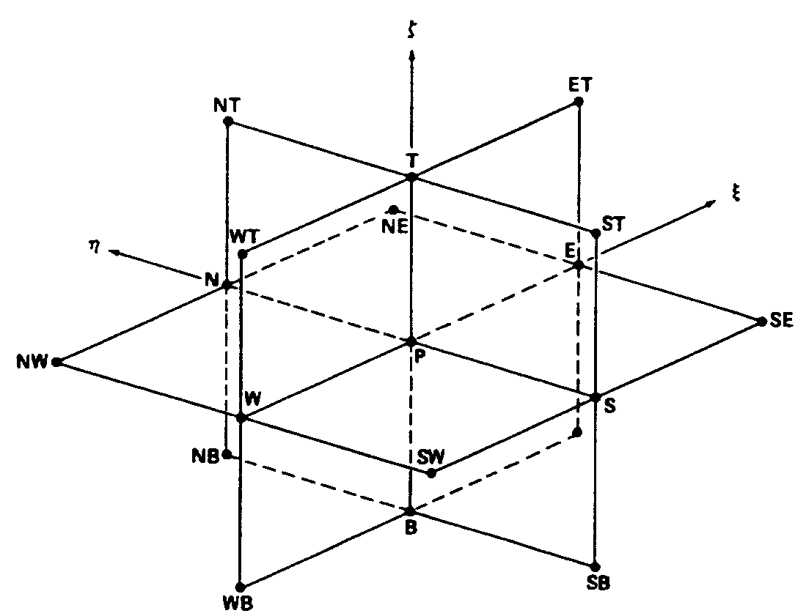

Figure 1. Three-dimensional grid structure and labeling around a grid node P.

<a id="p17"></a> <!-- printed page 7 -->

Thus, the nonlinear equations of motion are approximated by a system of linear algebraic equations which have the form of equation (6). Only one program subroutine is designed to calculate the link coefficients and the source terms. The number of algebraic equations depends on the number of interior grid points. For a grid size of $10 \times 10 \times 10$ the number of algebraic equations to be solved would be around 512. This large system of equations are preferred to be solved by some iterative methods, such as Gauss-Seidel iteration, line-underrelaxation method [13] or Stone's method [14], etc., rather than using direct methods such as Gaussian elimination method. Only a few (6 to 10) iterations through the whole computational domain are needed and a complete convergence of the system of algebraic equations is not required. Since equation (6) is only a linearized version of the governing equations which are nonlinear and coupled in nature, solutions of the equations of motion must be obtained through global iterations among the equations. A tentative solution to equation (6) will not affect the final results significantly. On the other hand, if too many iterations are used to get a better solution of equation (6), then a great deal of computing time would be virtually wasted. However, the above argument can not be applied when the pressure correction equation (which will be derived in the next section) is solved. Since during each global iteration it is desirable to retain a divergence-free velocity field, better solution of the pressure correction equation would in effect promote the convergence of the whole numerical scheme. Therefore, more iterations are usually used to solve the pressure correction equation.

## SOLUTION PROCEDURES

The governing equations used in the present analysis are nonlinear and strongly coupled. Iterative procedures are employed to drive the equations to a converged solution. It is particularly important for incompressible flow to make the flow field satisfy the continuity equation and the momentum equations at the same time. This requires a correct pressure field associated with a divergence-free velocity field. A velocity-pressure correction procedure is developed in the present study to drive the pressure field and the velocity field to be divergence free. This kind of procedure requires grid staggering between the velocity components and the locations where the pressure is estimated and stored such that the velocity field and the pressure field will not be uncoupled.

In the present study, staggering grid systems as shown in Figure 2 (for 2-D case) are used. The velocity components, $u$ and $v$, are solved and stored at the grid nodes and the pressure, $p$, is located at the corners of the control volume of $u$ and $v$. In this way, solutions of $u$ and $v$ can be solved using the same control volume and coupling between $u$, $v$ and $p$ can also be enforced. To estimate the pressure field, a pressure correction equation is derived approximately from the discretized momentum and continuity equations. The velocity and pressure fields are then corrected using the solutions of the pressure correction equation.

First, the finite difference momentum equations (for $u$, $v$ and $w$) can be written as:

```math
A_P^u u_P^* = \sum_i A_i^u u_i^* = P_x^* + S_u \qquad (8a)
```

<!-- as printed: the second = in (8a) and (8b) stands for a minus sign, as in (8c), (10) and (11) -->

<a id="p18"></a> <!-- printed page 8 -->

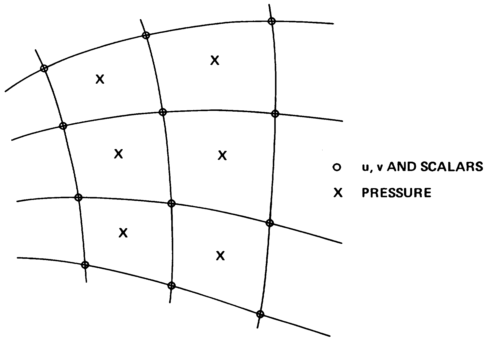

Figure 2. Locations where the variables are stored (staggering grids are used).

```math
A_P^V v_P^* = \sum_i A_i^V v_i^* = P_y^* + S_v \qquad (8b)
```

```math
A_P^W w_P^* = \sum_i A_i^W w_i^* - P_z^* + S_w \qquad (8c)
```

where $u^\ast$, $v^\ast$, $w^\ast$, and $p^\ast$ represent the solutions of equations (8a) and (8b). To satisfy the continuity equation the velocities and pressure are corrected according to the following relations:

```math
u = u^* + u' \qquad (9a)
```

```math
v = v^* + v' \qquad (9b)
```

```math
w = w^* + w' \qquad (9c)
```

```math
P = P^* + P' \qquad (9d)
```

<a id="p19"></a> <!-- printed page 9 -->

A new set of momentum equations can be constructed approximately using the divergence-free flow field, $u$, $v$, $w$, and $p$:

```math
A_P^u u_P = \sum_i A_i^u u_i - P_x + S_u \qquad (10a)
```

```math
A_P^V v_P = \sum_i A_i^V v_i - P_y + S_v \qquad (10b)
```

```math
A_P^W w_P = \sum_i A_i^W w_i - P_z + S_w \qquad (10c)
```

By subtracting equations (8a) through (8c) from equations (10a) through (10c), respectively, the following equations result:

```math
A_P^u u_P' = \sum_i A_i^u u_i' - P_x' \qquad (11a)
```

```math
A_P^V v_P' = \sum_i A_i^V v_i' - P_y' \qquad (11b)
```

```math
A_P^W w_P' = \sum_i A_i^W w_i' - P_z' \qquad (11c)
```

According to SIMPLE-C algorithm [11], equations (11a) through (11c) are rearranged to be:

```math
(A_P^u - \sum_i A_i^u) u_P' = \sum_i A_i^u (u_i' - u_P') - P_x' \qquad (12a)
```

```math
(A_P^v - \sum_i A_i^v) v_P' = \sum_i A_i^v (v_i' - v_P') - P_y' \qquad (12b)
```

```math
(A_P^w - \sum_i A_i^w) w_P' = \sum_i A_i^w (w_i' - w_P') - P_z' \qquad (12c)
```

<a id="p20"></a> <!-- printed page 10 -->

The first terms on the right-hand side of equations (12a) through (12c) are neglected to simplify the formulation. Thus,

```math
u_P' = - \left( \frac{1}{A_P^u - \sum_i A_i^u} \right) P_x' = - D_u P_x' \qquad (13a)
```

```math
v_P' = - \left( \frac{1}{A_P^v - \sum_i A_i^v} \right) P_y' = - D_v P_y' \qquad (13b)
```

```math
w_P' = - \left( \frac{1}{A_P^w - \sum_i A_i^w} \right) P_z' = - D_w P_z' \quad . \qquad (13c)
```

Using the decompositions of equations (9a) through (9c), the continuity equation can be written as:

```math
u_x + v_y + w_z = (u_x^* + v_y^* + w_z^*) + (u_x' + v_y' + w_z') = 0 \quad . \qquad (14)
```

Substituting equations (13a) through (13c) into equation (14), the following pressure correction equation can be obtained:

```math
-[(D_u P_x')_x + (D_v P_y')_y + (D_w P_z')_z] = -(u_x^* + v_y^* + w_z^*) \quad . \qquad (15)
```

Equation (15) is a Poisson's equation with the source term equal to the local divergence of the flow field. To enforce the coupling between the velocity and pressure fields, the source term of equation (15) is first evaluated at the control volumes centered between the velocity nodes as shown in Figure 3. An averaged source term is then calculated at the cell center of p node for solving equation (15). In this way, the difficulties in solving the pressure correction equation, as described by Vanka [4] and Maliska [6], are eliminated. Coupling between the velocity and the pressure field is also assured.

According to the above analyses, the present numerical method contains the following solution steps:

1) Guess initial velocity and pressure field.
2) Solve for the velocity field using equations (8a) through (8c).
3) Solve for other scalar transport equations.
4) Solve the pressure correction equation, equation (15).

<a id="p21"></a> <!-- printed page 11 -->

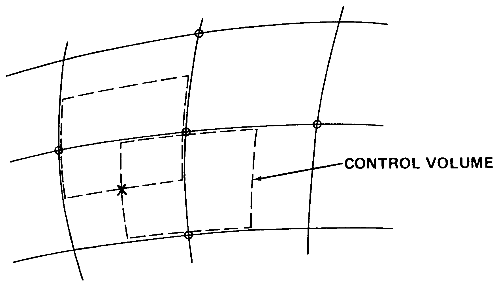

Figure 3. Control volumes where the mass conservation is evaluated for solving the pressure correction equation.

5) Correct the velocity and pressure fields using equations (13a) through (13c) and equation (9d).
6) Go back to step (2) until solution converges.

A converged solution is obtained when the following criterion is met:

```math
\text{Error} \equiv (|\Delta u|_{\max} + |\Delta v|_{\max} + |\Delta w|_{\max}) / U_{\text{ref}} + |P'|_{\max} / \rho U_{\text{ref}}^2
```

```math
\leq 3 \times 10^{-4} \quad ,
```

where $\Delta u$, $\Delta v$, and $\Delta w$ represent velocity changes during each iteration due to the solutions of the momentum equations.

In solving the momentum equations in step (b) above, underrelaxation factor of about 0.6 is recommended. With this, $A_p$ 's in equations (8a) through (8c) are modified according to the underrelaxation factor. For the correction of velocity field, no underrelaxation is required. But the correction of pressure field should be underrelaxed slightly (around 0.9) when the grid nonorthogonality is strong. This is different from that suggested by References 11 and 12 (which recommend no underrelaxation for pressure correction).

<a id="p22"></a> <!-- printed page 12 -->

## NUMERICAL EXAMPLES

In this section, several numerical examples are employed to demonstrate the efficiency and accuracy of the present numerical method. To serve this purpose, 2-D and 3-D, laminar and turbulent flow cases are included. These cases are: (a) 2-D laminar driven square-cavity flows; (b) 2-D laminar flows over a backward-facing step; (c) 2-D turbulent flows over a backward-facing step; (d) 3-D developing laminar flow inside a 90-deg-bend square duct. Detailed descriptions and results of the computation of the above cases are included as follows.

### A. 2-D Laminar Driven Square-Cavity Flows

The first test case is concerning laminar recirculating flows inside a square cavity. Only one side of the walls is moving at a constant speed tangent to that wall. This case has been studied extensively by Burggraf [15] and has often been used as one of the standard testing cases for numerical methods in solving the incompressible Navier-Stokes equations. Physical geometry and wall boundary conditions are illustrated in Figure 4. Reynolds number of the flow (based on the cavity size and the moving wall velocity) studied in the present analysis is 400. Two different mesh systems, as shown in Figure 5, are used to study the effect of grid non-orthogonality on the accuracy of the present method. The grid system of Figure 5(a) is uniform and orthogonal while the grid system of Figure 5(b) is non-uniform and non-orthogonal.

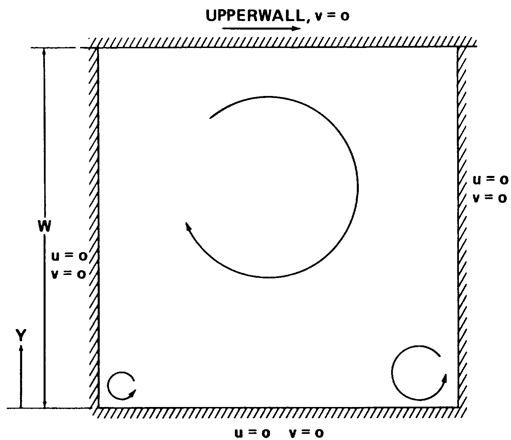

Figure 4. Physical geometry and wall boundary conditions for laminar flows inside a wall-driven square cavity.

<a id="p23"></a> <!-- printed page 13 -->

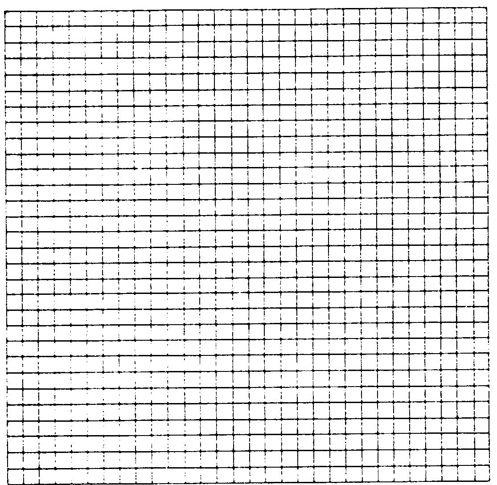

(a)

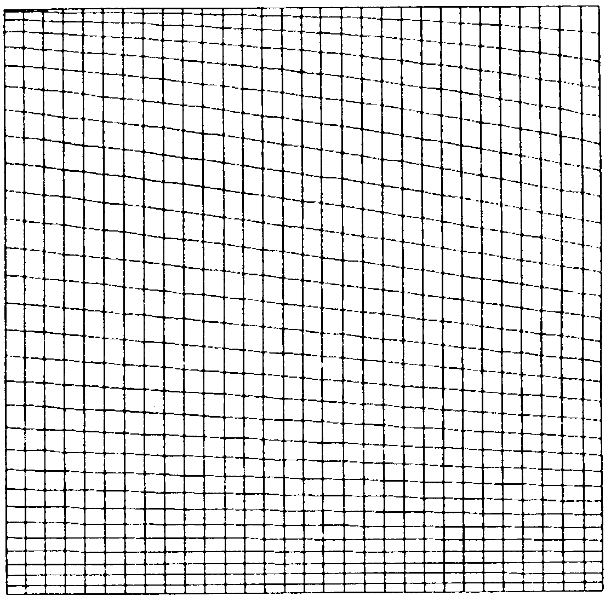

(b)

Figure 5. Mesh systems used for driven cavity problem. (a) Uniform and orthogonal grid. (b) Nonuniform and nonorthogonal grid.

<a id="p24"></a> <!-- printed page 14 -->

Results of the computations are shown in Figures 6 and 7. Velocity vector plots of the predicted flow fields are compared in Figure 6 for the mesh systems shown in Figure 5. Detailed comparisons of the predicted velocity profiles along the mid-section of the cavity are illustrated in Figure 7. Predicted results of Burggraf [15] are also included. Good agreements between the present calculations and those

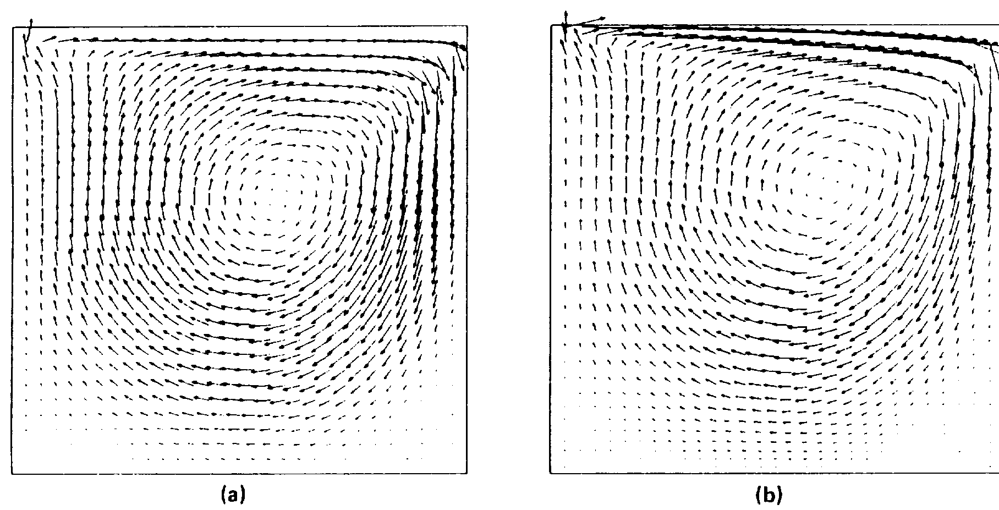

Figure 6. Velocity vector plots. (a) Orthogonal grid.  
(b) Nonorthogonal grid.

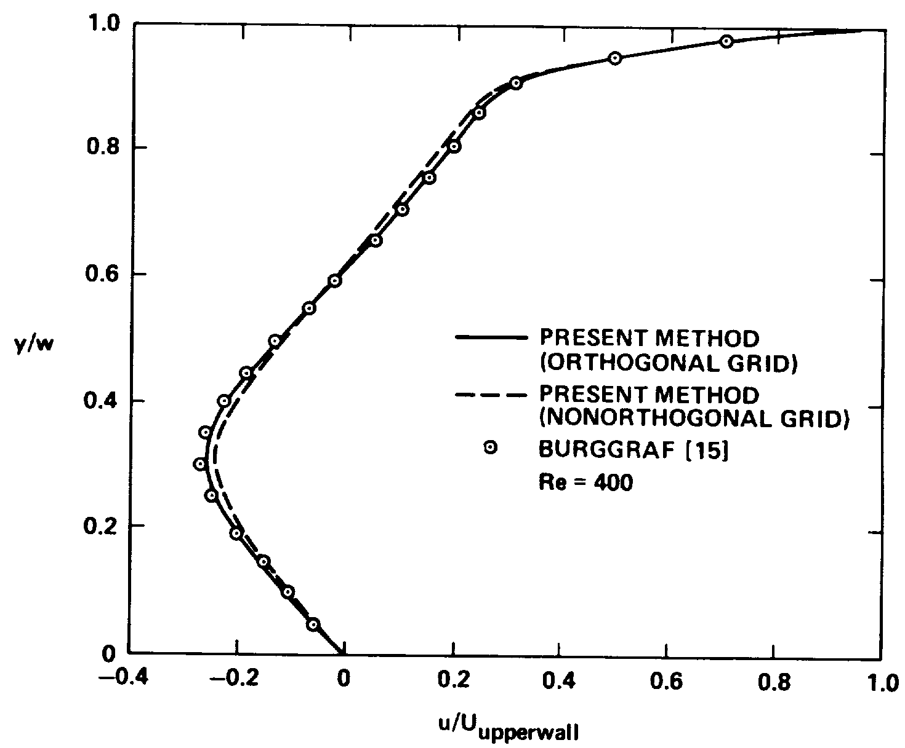

Figure 7. Comparisons of velocity profiles along the mid-section of the square cavity.

<a id="p25"></a> <!-- printed page 15 -->

of Burggraf [15] are also included. Good agreements between the present calculations and those of Burggraf are shown in Figure 7. Discrepancies between the present predictions and Burggraf's results are mainly due to the hybrid differencing scheme used in the present method. The upwind part of the hybrid scheme produces large numerical diffusion which tends to reduce the strength of the vorticity inside the cavity. Effects of differencing schemes in approximating the convection terms on the predicted results will be studied in the next test case.

Convergence history of the computation of the present case using uniform grids is given in Figure 8 which shows that the present numerical method is quite different. Almost identical convergence rates were found for the non-orthogonal case.

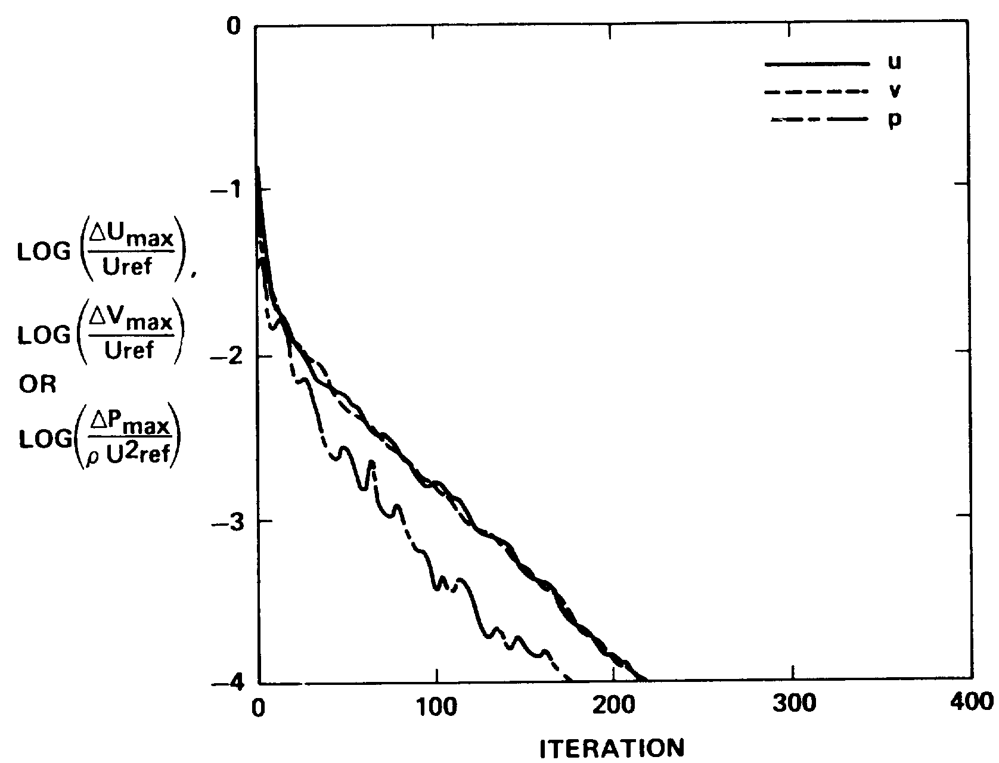

Figure 8. Convergence history for the driven cavity problem, $Re = 400$.

### B. 2-D Laminar Flows Over a Backward-facing Step

This test case concerns 2-D laminar recirculating flows over a backward-facing step with 1:2 expansion ratio. The dependence of the size of the recirculation region (characterized by the reattachment length) on the Reynolds number (based on the inlet bulk velocity and twice of the inlet channel width) of the flow is of major concern. The physical domain and boundary conditions are illustrated in Figure 9 in which a fully developed laminar flow velocity profile is imposed at the flow entrance. A non-uniform grid of $45 \times 45$ was used for numerical computations. Several cases with different Reynolds numbers from 100 to 800 have been studied. An experimental and theoretical study about this problem, which results will be used as the basis of data comparisons, has been provided by Amaly et al. [16].

<a id="p26"></a> <!-- printed page 16 -->

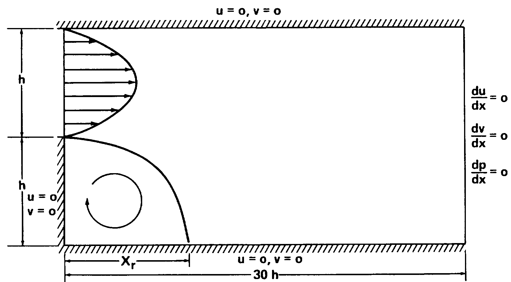

Figure 9. Physical geometry and boundary conditions of laminar flows over a backward-facing step (1:2 expansion).

To save computational efforts, the solution of one case with Reynolds number 100 is obtained in the first run. Then, a series of cases with increasing Reynolds numbers (i.e., 100, 200, 300, 400, 600, and 800) are calculated using the preceding results of lower Reynolds number as the initial guesses of the flow field. In this way, an average of 500 iterations for each case were needed to obtain converged solutions.

Two different differencing schemes in approximating the convection terms are employed to demonstrate the effects of the differencing schemes on the predictions. One of the schemes is the widely used hybrid scheme [9]. The other scheme employs the central differencing scheme plus an artificial dissipation term used to stabilize the solution which is similar to the one used by Rhie [17]. The artificial dissipation term becomes effective only when the cell Peclet number (or cell Reynolds number) exceeds 10.

Results of the present predictions using two different differencing schemes are compared with the experimental measurements [16] and other predictions as shown in Figure 10. It can be seen clearly from Figure 10 that the present method with hybrid scheme gives results similar to those predicted by TEACH code [16] while the present method with central differencing and artificial dissipation reveals predictions close to those predicted by INS3D [18] and the method of Kim and Moin [19]. This is reasonable since the TEACH code and the present method (with the first scheme) use the hybrid scheme which introduces large numerical dissipation by its upwind part (for cell Peclet number greater than 2). This tends to reduce the reattachment length for Reynolds number greater than 400. The second scheme, which is similar to the ones used in INS3D and the method of Kim and Moin, has the numerical accuracy close to second order by setting the artificial dissipation to be as small as the solution stability permits such that better accuracy of the predictions is expected.

<a id="p27"></a> <!-- printed page 17 -->

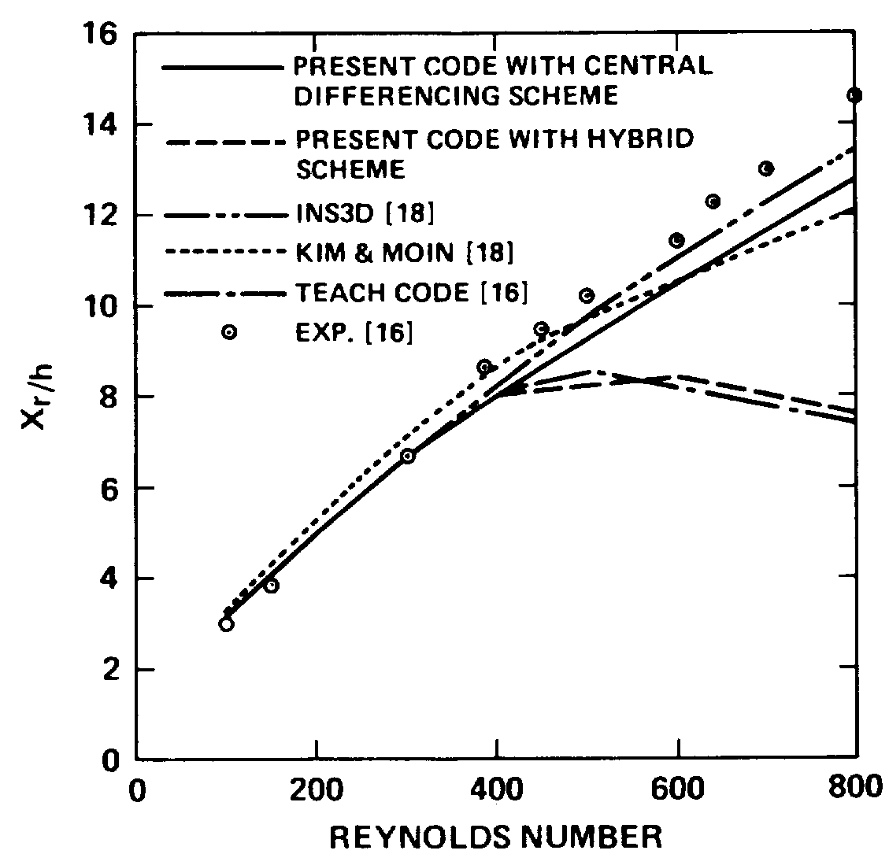

Figure 10. Reattachment length versus Reynolds number for laminar flows over a backward-facing step (1:2 expansion).

Stream function plots of the predictions using the two differencing schemes for Reynolds number 600 are compared in Figure 11. It is shown in Figure 11 that the second scheme gives a smooth shape of the recirculation zone while the hybrid scheme gives a sudden change in the shape of the recirculation region upstream of the reattachment point. Also, larger sizes of the separation regions on the step side wall and along the upper wall are predicted using the second scheme.

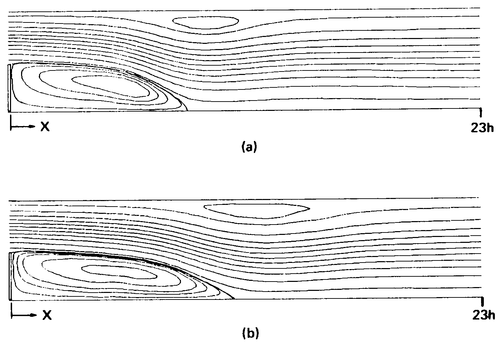

Figure 11. Streamline plots for laminar flow over a backward-facing step (1:2 expansion). (a) Hybrid Scheme. (b) Central differencing plus artificial dissipation scheme.

<a id="p28"></a> <!-- printed page 18 -->

### C. 2-D Turbulent Flows Over a Backward-Facing Step

In order to demonstrate the applicability of the present method to turbulent flow case, one of the standard test cases presented in the Stanford Conference [20] is selected here (i.e., turbulent flow over a 2:3 expansion backward-facing step). The standard $k-\epsilon$ turbulence model was used to provide the eddy viscosity for the transport equations. The physical geometry and boundary conditions imposed are shown in Figure 12. The calculation domain extends upstream of the expansion plane by 4 step heights and downstream of the expansion plane by 30 step heights to assure a fully developed velocity profile at the exit. A uniform velocity profile is located at the inlet plane. A $45 \times 42$ grid was used in the computation. 300 iterations were required to obtain converged solutions. Only hybrid differencing schemes were used in this case.

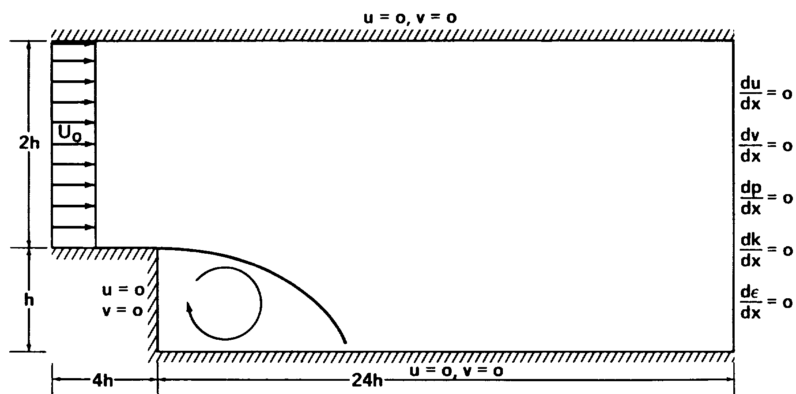

Figure 12. Physical geometry and boundary conditions of turbulent flows over a backward-facing step (2:3 expansion).

Results of the computation are shown in Figures 13, 14, and 15. These results are compared with the experimental measurements [20]. The under-prediction of the reattachment length is mainly due to the fast development of the mixing layer downstream of the expansion plane which is the characteristics of the standard $k-\epsilon$ turbulence model. Numerical diffusion provided by the hybrid scheme also contributes some part to the discrepancies between the predictions and measurements.

### D. Developing Laminar Flow Inside a 90-Deg-Bend Square Duct

This test case simulates a three-dimensional developing laminar flow inside a 90-deg-bend square duct as illustrated in Figure 16(a). The symmetry plane is located at $z = 0$ where the symmetric boundary conditions are imposed. A fully developed velocity profile of laminar flow inside a straight square duct is prescribed at the entrance which is 2.8 duct widths upstream of the bend. A zero pressure gradient exit (which is 4.5 duct widths downstream of the bend) boundary condition is imposed. The Reynolds number of the flow (based on the duct hydrolic diameter and the inlet bulk velocity) is 790. A 21 x 18 x 10 grid was used for numerical computations. The front view and side view of the mesh system are illustrated in Figure 16(b). Experimental measurements of Humphrey et al. [21] are used for data comparisons.

<a id="p29"></a> <!-- printed page 19 -->

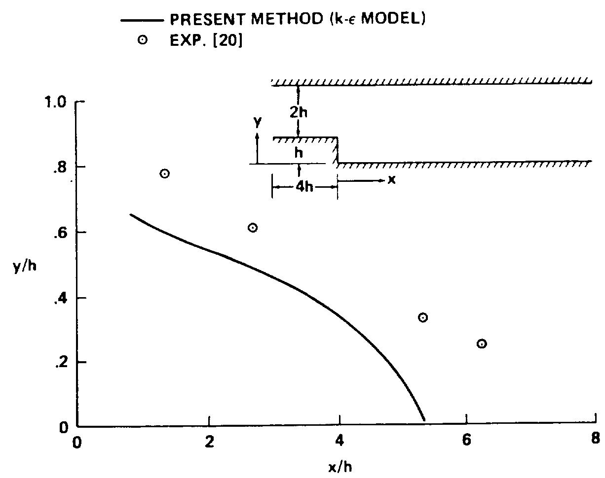

Figure 13. Locus of flow reversal inside the recirculation region for turbulent flow over a backward-facing step (2:3 expansion).

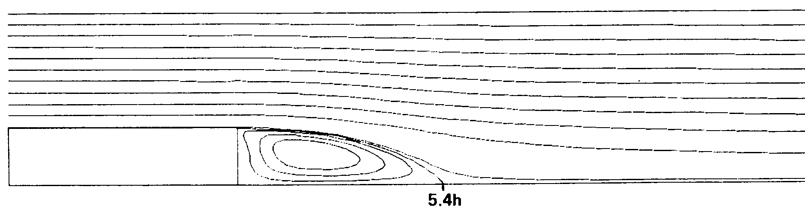

Figure 14. Stream line pattern of turbulent flow over a backward-facing step with 2:3 expansion ratio.

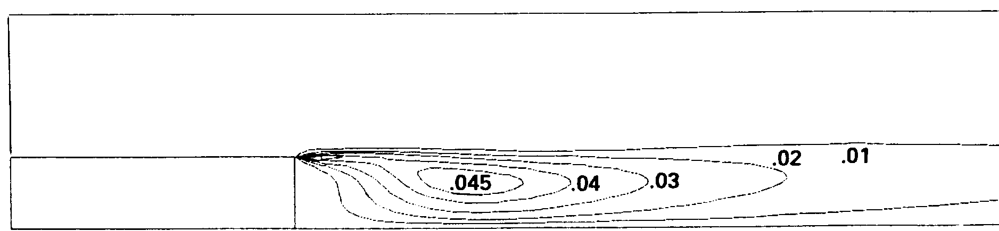

Figure 15. Contours of turbulent kinetic energy ( $k/U_0^2$) of turbulent flow over a backward-facing step with 2:3 expansion ratio.

<a id="p30"></a> <!-- printed page 20 -->

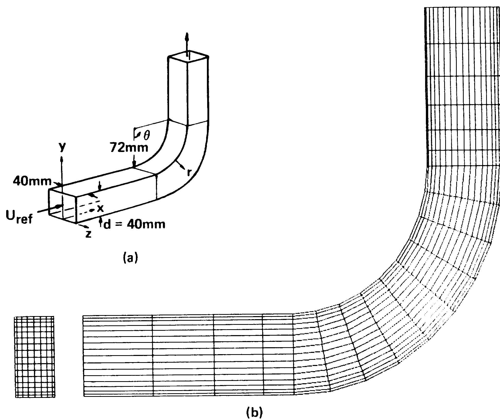

Figure 16. Geometry and mesh system of a 90-deg-bend square duct developing laminar flow problem.


Velocity vector plots on three sections along the main flow directions (i.e., on x-y plane) are shown in Figure 17. Secondary flow patterns at several stations across the bend are illustrated in Figure 18. These results are very similar to those obtained by Vanka [22] and Rhie [23]. Grid sizes of 50 x 22 x 15 and 58 x 15 x 11 were used by Rhie and Vanka, respectively. The present investigation, using only less than half of their grid numbers, gives highly encouraging results. Detailed comparisons between the measured and the predicted main velocity profiles are given in Figure 19.

With the above successful numerical simulations, it is believed that the present numerical method can be applied to general fluid dynamics problems with good numerical accuracy and efficiency.

<a id="p31"></a> <!-- printed page 21 -->

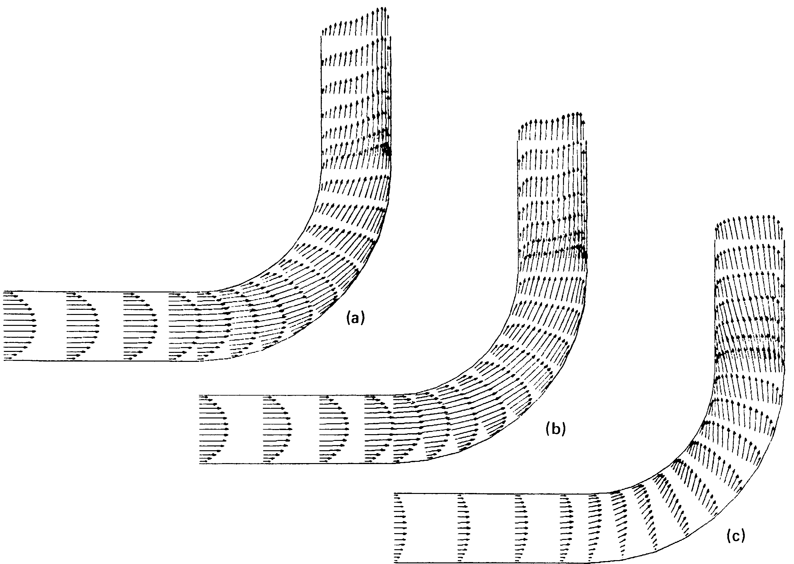

Figure 17. Primary velocity patterns of laminar flow inside a 90-deg-bend square duct.  
(a) $z/d = 0.0$. (b) $z/d = 0.25$. (c) $z/d = 0.48$.

<a id="p32"></a> <!-- printed page 22 -->

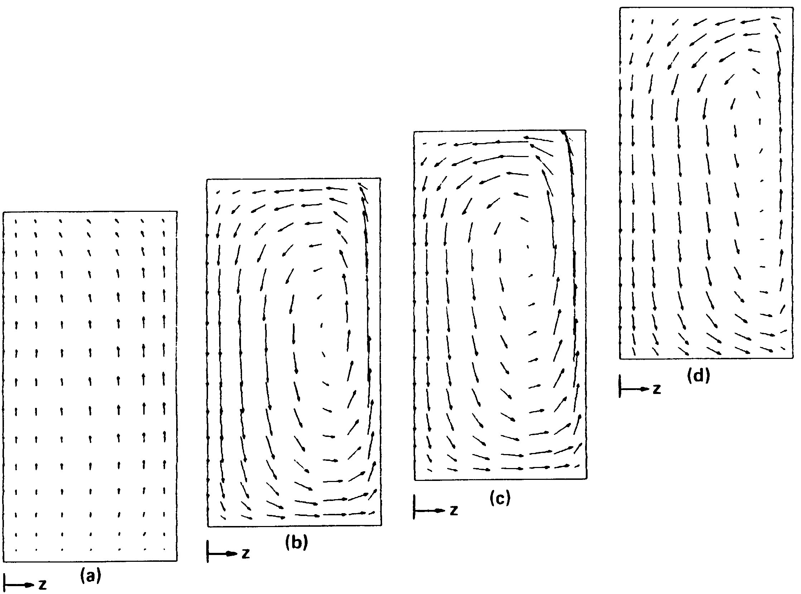

Figure 18. Secondary velocity patterns of laminar flow inside a 90-deg bend. (a) $\theta = 0$ deg. (b) $\theta = 30$ deg. (c) $\theta = 60$ deg. (d) $\theta = 90$ deg.

<a id="p33"></a> <!-- printed page 23 -->

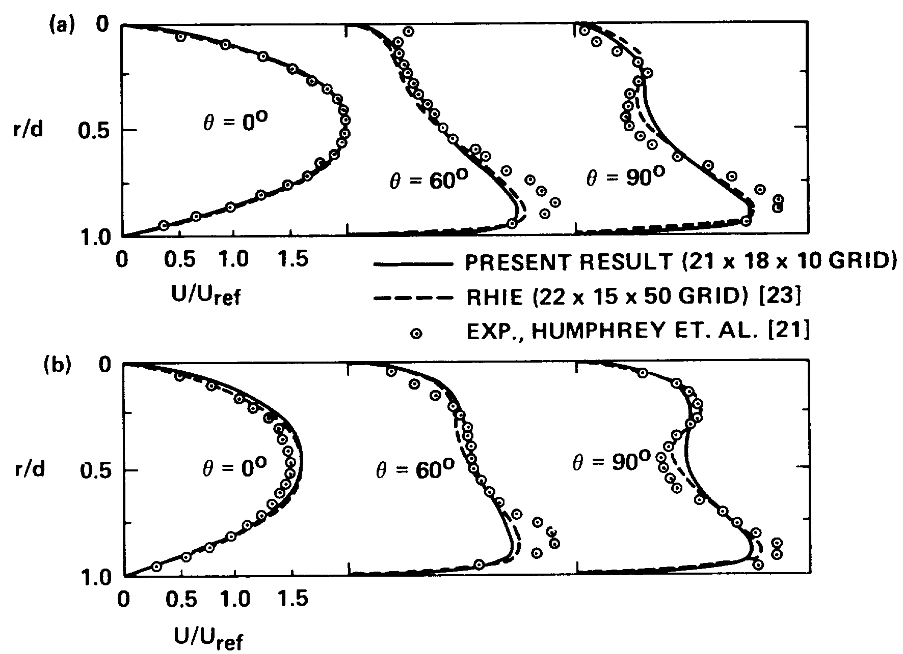

Figure 19. Primary velocity profiles for a 3-D 90-deg-bend square duct. (a) $z/d = 0.0$. (b) $z/d = 0.25$.

## CONCLUSIONS

A numerical method for solving the steady or transient incompressible Navier-Stokes equations in three-dimensional body-fitted coordinate systems has been developed. In the present paper, the basic numerical algorithms and grid arrangements have been described in detail. A brief user's guide to the present computer code (CNS3D) has been included in Appendix A. A program listing has also been attached in Appendix C.

Several numerical testing examples of 2-D and 3-D, laminar and turbulent flow problems included in the present work have demonstrated that the present computer code is efficient and robust, and can be used as a reliable tool for engineering design and analysis applications. Applications of the present code to the internal turbulent flow problems of the SSME will be presented in the future publications.

<a id="p34"></a> <!-- printed page 24 -->

## REFERENCES

1. Chorin, A. J.: A Numerical Method for Solving Incompressible Viscous Flow Problems. *Journal of Comp. Physics*, Vol. 2, 1967, pp. 12-26.
2. Steger, J. L. and Kutler, P.: Implicit Finite-Difference Procedures for the Computation of Vortex Wakes. *AIAA J.*, Vol. 15, No. 4, April 1977, pp. 581-590.
3. Kwak, D., Chang, J. L. C., Shanks, S. P., and Chakravarthy, S.: An Incompressible Navier-Stokes Flow Solver in Three-Dimensional Curvilinear Coordinate Systems Using Primitive Variables. *AIAA Paper 80-0253*, Reno, Nev., Jan. 1984.
4. Vanka, S. P., Chen, B. C.-J., and Sha, W. T.: A Semi-Implicit Calculation Procedure for Flows Described in Boundary-Fitted Coordinates Systems. *Numerical Heat Transfer*, Vol. 3, 1980, pp. 1-19.
5. Shyy, W., Tong, S. S., and Correa, S. M.: Numerical Recirculating Flow Calculation Using a Body-Fitted Coordinate System. *Numerical Heat Transfer*, Vol. 8, 1985, pp. 99-113.
6. Maliska, C. R., and Raithby, G. D.: A Method for Computing Three Dimensional Flows Using Non-Orthogonal Boundary-Fitted Coordinates. *International J. for Numerical Methods in Fluids*, Vol. 4, 1984, pp. 519-537.
7. Launder, B. E., and Spalding, D. B.: Mathematical Models of Turbulence. Academic Press, London, 1972.
8. Launder, B. E., and Spalding, D. B.: The Numerical Computation of Turbulent Flows. *Comp. Meth. Appl. Mech. Engr.*, Vol. 3, 1974, pp. 269-289.
9. Patankar, S. V.: Numerical Heat Transfer and Fluid Flow. McGraw-Hill Book Company, 1980.
10. Syed, Saadat A., Chiappetta, L. M., and Gosman, A. D.: Error Reduction Program - Final Report. NASA CR-174776, January 11, 1985.
11. Van Doormal, J. P., and Raithby, G. D.: Enhancements of the SIMPLE Method for Predicting Incompressible Fluid Flows. *Numerical Heat Transfer*, Vol. 7, 1984, pp. 147-163.
12. Latimer, B. R. and Pollard, A.: Comparison of Pressure-Velocity Coupling Solution Algorithms. *Numerical Heat Transfer*, Vol. 8, 1985, pp. 635-652.
13. Anderson, D. A., Tannehill, J. C., and Pletcher, R. H.: Computational Fluid Mechanics and Heat Transfer. McGraw-Hill Book Company, 1984.
14. Stone, H. L.: Iterative Solution of Implicit Approximations of Multidimensional Partial Differential Equations. *SIAM J. Numer. Anal.*, Vol. 5, pp. 530-558.
15. Burggraf, O. R.: Analytical and Numerical Studies of the Structure of Steady Separated Flows. *J. Fluid Mech.*, Vol. 24, Part 1, 1966, pp. 113-151.

<a id="p35"></a> <!-- printed page 25 -->

16. Armaly, B. F., Durst, F., Pereira, J. C. F., and Schönung, B.: Experimental and Theoretical Investigation of Backward-Facing Step Flow. *J. Fluid Mech.*, Vol. 127, 1983, pp. 473-496.
17. Rhie, C. M.: A Pressure Based Navier-Stokes Solver Using the Multigrid Method. *AIAA Paper 86-0207*, Reno, Nev., January 1986.
18. Rogers, S. E., Kwak, D., and Kaul, U.: On the Accuracy of the Pseudo-compressibility Method in Solving the Incompressible Navier-Stokes Equations. *AIAA Paper 85-1689*, *AIAA 18th Fluid Dynamics and Plasmadynamics and Laser Conference*, July 16-18, 1985, Cincinnati, Ohio.
19. Kim, J. and Moin, P.: Application of a Fractional-Step Method to Incompressible Navier-Stokes Equations. *J. of Comp. Phy.*, Vol. 59, 1985, pp. 308-323.
20. Kline, S. J., Cantwell, B. J., and Lilley, G. M. (Ed.): The 1980-1981 AFOSR-HTTM-Stanford Conference on Complex Turbulent Flows. Stanford University, I, II and III.
21. Humphrey, J. A. C., Taylor, A. M. K., and Whitelaw, J. H.: Laminar Flow in a Square Duct of Strong Curvature. *J. Fluid Mech.*, Vol. 83, Part 3, 1977, p. 509.
22. Vanka, S. P.: Block-Implicit Calculations of Three-Dimensional Laminar Flow in Strongly Curved Ducts. *AIAA J.*, Vol. 23, No. 12, December 1985, p. 1989.
23. Rhie, C. M.: A Three-Dimensional Passage Flow Analysis Method Aimed at Centrifugal Impellers. *Computers and Fluids*, Vol. 13, No. 4, 1985, pp. 443-460.
24. Chieng, C. C. and Launder, B. E.: On the Calculation of Turbulent Heat Transport Downstream from an Abrupt Pipe Expansion. *Numerical Heat Transfer*, Vol. 3, 1980, pp. 189-207.
25. Amano, R. S.: Development of a Turbulence Near-Wall Model and Its Application to Separated and Reattached Flows. *Numerical Heat Transfer*, Vol. 7, 1984, pp. 59-75.
26. Chen, Y. S.: Applications of a New Wall Function to Turbulent Flow Computations. *AIAA Paper 86-0438*, Reno, Nev., January 1986.

<a id="p36"></a>

<a id="p37"></a> <!-- printed page 27 -->

## APPENDIX A. COMPUTER CODE STRUCTURES AND USER'S GUIDE

The global structure of the present computer code (CNS3D) can be represented by a flow chart, shown in Figure A-1. The user is referred to Appendix C for detailed information. First, the program requests inputs, from logic unit 5 (LU = 5), of program control parameters that specify the maximum number of iterations, the type of flow (i.e., laminar or turbulent), number of iterations for solving the pressure correction equation (typically 10), and underrelaxation factors for solving the transport equations, etc. This is followed by the definitions of all the program constants including turbulence model constants (these constants are subject to change according to the user's specific flow problem). Next, the program asks for inputs of the initial flow field guess from a restart file (LU = 8) which contains the grid system coordinates and flow field data that may be created by the user (including grid generation) or obtained from the previous solutions. Format of this data file is also subject to change according to the user's preference. Next, wall boundary control parameters, boundary grid normal distance to the wall, and wall boundary direction cosine are calculated in subroutine DIRCOS. Subroutine TRANF is then invoked to obtain the grid transformation coefficients. Before the solution procedure starts, the inlet mass flow rate is calculated which will be used to control the outlet mass flow rate to enhance mass conservation. The solution procedures consist of a series of subroutine calls to SOLVEQ starting from the solutions of the velocity vectors, u, v, and w, and then the solutions of scalar quantities (including the energy equation and the turbulence model equations) and finally the solution of the pressure correction equation to update the velocity and pressure field such that a divergence-free flow field can be retained.

After each global iteration of the solution procedures, the numerical of iterations and the maximum flow field corrections are checked with the initial settings. If the convergence criterion is satisfied or the number of iterations reaches the prescribed value then the solution procedures stop and the flow field solutions will be written on the pre-assigned disc file (LU = 7).

For instance, if a steady-state laminar flow problem (Reynolds number of 600) is of interest and a converged solution is expected within 300 iterations and the number of iterations for solving the pressure correction equation is 10 and the underrelaxation factors are 0.5 and 0.95 for transport equations and pressure correction equation, respectively, the first inputs from LU = 5 would be:

<table><thead><tr><th colspan="9"><u>Line</u></th></tr></thead><tbody><tr><td>1.</td><td>300</td><td>1</td><td>10</td><td>1</td><td></td><td></td><td></td><td></td></tr><tr><td>2.</td><td>0.5</td><td>0.5</td><td>0.5</td><td>0.95</td><td>0.5</td><td>0.5</td><td>0.5</td><td>0.5</td></tr><tr><td>3.</td><td>600.</td><td>0.0</td><td></td><td></td><td></td><td></td><td></td><td></td></tr></tbody></table>

In the second input sequence (i.e., from restart file), the program reads in $L \times M \times N$ lines of data records. See Figure A-2 for grid structures. Notice that the program requires variable dimensions of $(L+1, M+1, N+1)$ for solving the pressure correction equation. It is important to check the COMMON table for proper variable dimensions.

<a id="p38"></a> <!-- printed page 28 -->

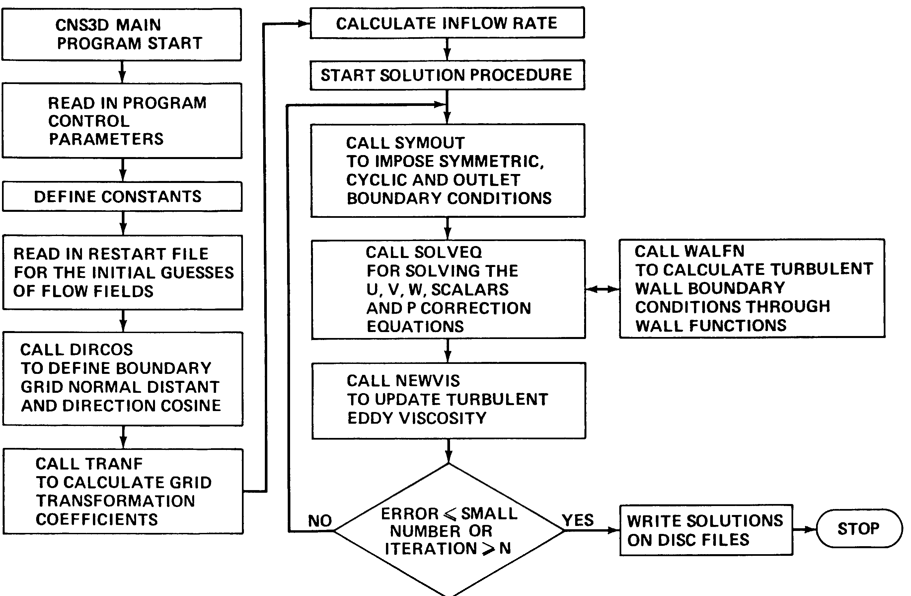

Figure A-1. Global structure of the present computer program CNS3D.

<a id="p39"></a> <!-- printed page 29 -->

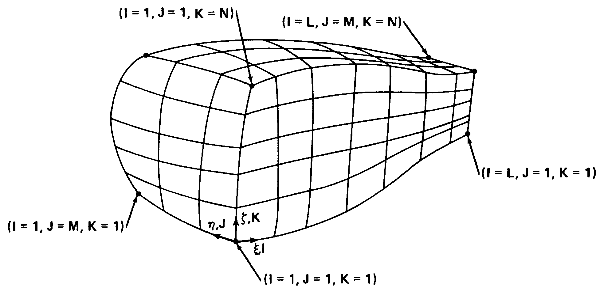

Figure A-2. Grid mesh structures for 3-D calculations.

If the flow problem involves symmetric or cyclic boundary conditions, then the user can look into the subroutine SYMOUT to specify the appropriate boundary conditions (the conditions shown in the program listing of Appendix C are for symmetric boundary conditions at $K = 1$). For cyclic boundary conditions at $K = 1$ and $K = N$, data at $K = 2$ and $K = N-1$ can be used to obtain boundary conditions at $K = 1$ and $K = N$ by requiring same gradients across $K = 1$ and $K = N$. This method is simple but will lag the boundary conditions by one iteration. A direct method without lagging the boundary conditions can also be employed by modifying the subroutine of linear algebra solver LINERX such that the boundary conditions can be part of the solution of the TDMA (tridiagonal matrix) solver.

In case of incorporating different wall functions for turbulent flow problems (e.g., References 24, 25, and 26), subroutine BOUNC and WALFN can be modified according to the user's method of wall treatments. The set of wall functions given in the program listing of Appendix C are derived from the conventional wall law and the equilibrium turbulent kinetic energy relations [8].

When additional source terms are to be added to the transport equations due to flow problem requirements, modifications to the source term calculation section in the subroutine SOLVEQ can be carried out. Notice that in the subroutine SOLVEQ source terms for the velocities $v$ and $w$ are included in the $u$ -source section. Purpose of this is to save some computing time since these source terms use similar calculation routines.

Some times it is required to solve more transport equations other than the basic ones included in Appendix C. To modify the program to incorporate more equations, <a id="p40"></a> <!-- printed page 30 --> several changes are necessary. First, new variables must be added to the COMMON table (this can be easily done through the computer editor session). Then, new source term sections are added in the SOLVEQ subroutine. Finally, subroutines WALFN and SYMOUT are modified to incorporate the new variables into the boundary condition setting routines.

<a id="p41"></a> <!-- printed page 31 -->

## APPENDIX B. LIST OF FORTRAN SYMBOLS

|  |  |
|---|---|
| A(K) | = Matrix elements of a tridiagonal matrix |
| AB(I,J,K) | = Link coefficients through the bottom face of a control volume |
| AE(I,J,K) | = Link coefficients through the east face of a control volume |
| ALC | = Underrelaxation factor for symmetry or cyclic boundary conditions |
| ALE | = Underrelaxation factor for the $\epsilon$-equation |
| ALK | = Underrelaxation factor for the k-equation |
| ALP | = Underrelaxation factor for the pressure correction equation |
| ALU | = Underrelaxation factor for the u-equation |
| ALV | = Underrelaxation factor for the v-equation |
| ALVIS | = Underrelaxation factor for the effective viscosity |
| ALW | = Underrelaxation factor for the w-equation |
| AN(I,J,K) | = Link coefficient through the north face of a control volume |
| ANAB | = Sum of the link coefficients at all faces |
| ANV1(I) | = Modified wall boundary link coefficient for v-equation |
| ANW1(I) | = Modified wall boundary link coefficient for w-equation |
| AP(I,J,K) | = Sum of the link coefficients around a control volume |
| APO(I,J,K) | = Link coefficients in time marching direction |
| ARDEN | = Area times density across a section in physical domain |
| AREA | = Area of a section in physical domain |
| AS(I,J,K) | = Link coefficients through the south face of a control volume |
| AT(I,J,K) | = Link coefficients through the top face of a control volume |
| AW(I,J,K) | = Link coefficients through the west face of a control volume |
| B(K) | = Matrix elements of a tridiagonal matrix |
| BB(I,J,K) | = Coefficients in Stone's partial factorization technique |
| BOUNC | = Subroutine for getting turbulent wall boundary conditions through wall functions |
| C(K) | = Matrix elements of a tridiagonal matrix |
| C1 | = Turbulence model constant, = 1.44 <!-- the program listing sets C1=1.43 --> |
| C2 | = Turbulence model constant, = 1.92 |
| CB | = Convective flux through the bottom face of a control volume |
| CE | = Convective flux through the east face of a control volume |
| CK | = Von Karman constant, = 0.4 |
| CMU | = Turbulence model constant, = 0.09 |
| CMU1 | = CMU\*\*0.25 |
| CMU2 | = CMU\*\*0.75 |
| CN | = Convective flux through the north face of a control volume |
| CS | = Convective flux through the south face of a control volume |
| CT | = Convective flux through the top face of a control volume |
| CW | = Convective flux through the west face of a control volume |
| CX(I,J,K) | = Grid transformation coefficient, $\xi_x$ |
| CY(I,J,K) | = Grid transformation coefficient, $\xi_y$ |
| CZ(I,J,K) | = Grid transformation coefficient, $\xi_z$ |
| D(K) | = Matrix elements of a tridiagonal matrix |
| DDB | = Diffusive flux through the bottom face of a control volume |
| DDE | = Diffusive flux through the east face of a control volume |
| DDN | = Diffusive flux through the north face of a control volume |
| DDS | = Diffusive flux through the south face of a control volume |
| DDT | = Diffusive flux through the top face of a control volume |
| DDW | = Diffusive flux through the west face of a control volume |
| DE(I,J,K) | = Turbulent kinetic energy dissipation rate, $\epsilon$ |
| DEO(I,J,K) | = DE at the previous time level |
| DEN(I,J,K) | = Density of the fluid |
| DENO(I,J,K) | = DEN at the previous time level |
| DENC | = Density at the center of a surface |
| DENIN | = Initial value of density of the fluid |
| DIRCOS | = Subroutine for calculating the boundary grid sizes and direction cosines |
| DITM | = Wall boundary average value of dissipation rate |
| DK(I,J,K) | = Turbulent kinetic energy, $k$ |
| DKO(I,J,K) | = DK at the previous time level |
| DTT | = Time step size, $\Delta t$ |
| DU(I,J,K) | = Diffusive coefficient for the $p'$-equation |
| DV(I,J,K) | = Diffusive coefficient for the $p'$-equation |
| DW(I,J,K) | = Diffusive coefficient for the $p'$-equation |
| E | = Wall law constant, = 9.01069 |
| EREXT | = Convergence criterion tolerance |
| ERRE | = Maximum correction in $\epsilon$ |
| ERRF | = Maximum correction of a variable |
| ERRK | = Maximum correction in $k$ |
| ERRM | = Maximum correction in $p$ |
| ERRU | = Maximum correction in $u$ |
| ERRV | = Maximum correction in $v$ |
| ERRW | = Maximum correction in $w$ |
| EX(I,J,K) | = Grid transformation coefficient, $\eta_x$ |
| EY(I,J,K) | = Grid transformation coefficient, $\eta_y$ |
| EZ(I,J,K) | = Grid transformation coefficient, $\eta_z$ |
| F(I,J,K) | = Tentative variable of the transport equations |
| FO(I,J,K) | = F at the previous time level |
| F1(I,J,K) | = Variable quantity at the previous iteration step |
| FLOW | = Outlet mass flow rate |
| FLOWIN | = Inlet mass flow rate |
| GEN(I,J,K) | = Turbulent kinetic energy production rate |
| HINUM | = Large number, = 1.E30 |
| I | = Index along the $\xi$ grid lines |
| IBC(I) | = Boundary grid index |
| IE | = Index assigned for the transport equations |
| IG | = Problem control parameter, =1 for laminar flow and =2 for turbulent flow |
| IITO | = Total number of wall boundary grids |
| IITY | = Boundary grid face type |
| IJLO(I,J,K) | = Boundary grid sequential order |
| INIT | = Subroutine for initializing variables |
| INPRO | = Logical parameter for updating the effective viscosity |
| INSOE | = Logical parameter for solving the $\epsilon$-equation |
| INSOK | = Logical parameter for solving the k-equation |
| INSOP | = Logical parameter for solving the p'-equation |
| INSOT | = Logical parameter for solving the T-equation |
| INSOU | = Logical parameter for solving the u-equation |
| INSOV | = Logical parameter for solving the v-equation |
| INSOW | = Logical parameter for solving the w-equation |
| IS | = Starting value of I of the solution domain |
| ISWE | = Number of sweeps for solving the $\epsilon$-equation |
| ISWK | = Number of sweeps for solving the k-equation |
| ISWP | = Number of sweeps for solving the p'-equation |
| ISWU | = Number of sweeps for solving the u-equation |
| ISWV | = Number of sweeps for solving the v-equation |
| ISWW | = Number of sweeps for solving the w-equation |
| IT | = Last value of I of the solution domain |
| ITT | = Number of time steps |
| J | = Index along the $\eta$ grid lines |
| JBC(I) | = Boundary grid index |
| JS | = Starting value of J of the solution domain |
| JT | = Last value of J of the solution domain |
| K | = Index along the $\zeta$ grid lines |
| KBC(I) | = Boundary grid index |
| KS | = Starting value of K of the solution domain |
| KT | = Last value of K of the solution domain |
| L | = Maximum dimension of grid system in I direction |
| LO | = L + 1 |
| L1 | = Starting point of blockage region in I direction |
| L2 | = Last point of blockage region in I direction |
| LINERX | = Subroutine for solving algebraic equations |
| LT | = L - 1 |
| M | = Maximum dimension of grid system in J direction |
| MO | = M + 1 |
| M1 | = Starting point of blockage region in J direction |
| M2 | = Last point of blockage region in J direction |
| MC(I,J,K) | = Wall blockage region control parameter |
| MT | = M - 1 |
| N | = Maximum dimension of grid system in K direction |
| NO | = N + 1 |
| N1 | = Starting point of blockage region in K direction |
| N2 | = Last point of blockage region in K direction |
| NEWVIS | = Subroutine for updating the effective viscosity |
| NLIMT | = Limit of maximum number of iterations |
| NT | = N - 1 |
| P | = Static pressure (relative) |
| PCXI | = Pressure gradient, $P_{\xi}$ |
| PDUV | = Blockage control parameter for link coefficients |
| PEDA | = Pressure gradient, $p_{\eta}$ |
| PP | = Pressure correction, $p'$ |
| PPBLK | = Global pressure correction |
| PSCI | = Pressure gradient, $P_{\zeta}$ |
| PTA | = Wall boundary source term for the momentum equations |
| PW | = Wall value control parameter |
| RENL | = Reynolds number of the fluid |
| SIGE | = Turbulence model constant, = 1.3 |
| SIGK | = Turbulence model constant, = 1.0 |
| SINX(I) | = Wall boundary direction cosine |
| SINY(I) | = Wall boundary direction cosine |
| SINZ(I) | = Wall boundary direction cosine |
| SMNUM | = Small number, 1.E-30 |
| SOC1 | = Source term due to shear stress |
| SOC2 | = Source term due to shear stress |
| SOC3 | = Source term due to shear stress |
| SOLVEQ | = Subroutine for solving general transport equation |
| SP(I,J,K) | = Linear part of the source term |
| SPK(I,J,K) | = Secondary linear part of the source term |
| SU(I,J,K) | = Constant part of the source term |
| SUK(I,J,K) | = Secondary constant part of the source term |
| SX(I,J,K) | = Grid transformation coefficient, $\zeta_x$ |
| SY(I,J,K) | = Grid transformation coefficient, $\zeta_y$ |
| SYMOUT | = Subroutine for setting flow boundary conditions |
| SZ(I,J,K) | = Grid transformation coefficient, $\zeta_z$ |
| TAUN(I) | = Wall shear stress |
| TIMT | = Total time |
| TJO(I,J,K) | = Jacobian of metric transformation |
| TM(I,J,K) | = Temperature |
| TMO(I,J,K) | = TM at the previous time level |
| TMULT | = Wall shear stress |
| TRANF | = Subroutine for calculating the grid transformation coefficients |
| TXXE(I,J,K) | = Metric coefficient for east face diffusive flux |
| TXXW(I,J,K) | = Metric coefficient for west face diffusive flux |
| TXYN(I,J,K) | = Metric coefficient for north face diffusive flux |
| TXYS(I,J,K) | = Metric coefficient for south face diffusive flux |
| TXZT(I,J,K) | = Metric coefficient for top face diffusive flux |
| TXZB(I,J,K) | = Metric coefficient for bottom face diffusive flux |
| TYYN(I,J,K) | = Metric coefficient for north face diffusive flux |
| TYYS(I,J,K) | = Metric coefficient for south face diffusive flux |
| TYXE(I,J,K) | = Metric coefficient for east face diffusive flux |
| TYXW(I,J,K) | = Metric coefficient for west face diffusive flux |
| TYZT(I,J,K) | = Metric coefficient for top face diffusive flux |
| TYZB(I,J,K) | = Metric coefficient for bottom face diffusive flux |
| TZZT(I,J,K) | = Metric coefficient for top face diffusive flux |
| TZZB(I,J,K) | = Metric coefficient for bottom face diffusive flux |
| TZXE(I,J,K) | = Metric coefficient for east face diffusive flux |
| TZXW(I,J,K) | = Metric coefficient for west face diffusive flux |
| TZYN(I,J,K) | = Metric coefficient for north face diffusive flux |
| TZYS(I,J,K) | = Metric coefficient for south face diffusive flux |
| U(I,J,K) | = U-velocity |
| UO(I,J,K) | = U at the previous time level |
| UC | = Velocity at the center of a surface |
| UCXI | = U-velocity gradient, $u_{\xi}$ |
| UEDA | = U-velocity gradient, $u_{\eta}$ |
| UINC | = Velocity correction at outlet plane |
| USCI | = U-velocity gradient, $u_{\zeta}$ |
| UX | = U-velocity gradient, $u_x$ |
| UY | = U-velocity gradient, $u_y$ |
| UZ | = U-velocity gradient, $u_z$ |
| V(I,J,K) | = V-velocity |
| VO(I,J,K) | = V at the previous time level |
| VISC | = Molecular viscosity, $\mu$ |
| VISE(I,J,K) | = Effective viscosity, $\mu_{\text{eff}}$ |
| VCXI | = V-velocity gradient, $v_{\xi}$ |
| VEDA | = V-velocity gradient, $v_{\eta}$ |
| VSCI | = V-velocity gradient, $v_{\zeta}$ |
| VX | = V-velocity gradient, $v_x$ |
| VY | = V-velocity gradient, $v_y$ |
| VZ | = V-velocity gradient, $v_z$ |
| W(I,J,K) | = W-velocity |
| WO(I,J,K) | = W at the previous time level |
| WALLFN | = Subroutine for calculating the wall functions |
| WALVAL | = Subroutine for assigning wall values |
| WCXI | = W-velocity gradient, $w_{\xi}$ |
| WEDA | = W-velocity gradient, $w_{\eta}$ |
| WSCI | = W-velocity gradient, $w_{\zeta}$ |
| WX | = W-velocity gradient, $w_x$ |
| WY | = W-velocity gradient, $w_y$ |
| WZ | = W-velocity gradient, $w_z$ |
| X(I,J,K) | = X-coordinate |
| Y(I,J,K) | = Y-coordinate |
| YN(I) | = Wall normal distance from the last grid |
| YN1(I) | = Wall grid volume size |
| YPLN(I) | = Nondimensionalized YN, $y^+ = u_\tau y / \nu$ |
| Z(I,J,K) | = Z-coordinate |

<a id="p42"></a> <!-- printed page 32 -->
<a id="p43"></a> <!-- printed page 33 -->
<a id="p44"></a> <!-- printed page 34 -->
<a id="p45"></a> <!-- printed page 35 -->
<a id="p46"></a> <!-- printed page 36 -->
<a id="p47"></a> <!-- printed page 37 -->
<a id="p48"></a> <!-- printed page 38 -->
<a id="p49"></a> <!-- printed page 39 -->

<a id="p50"></a>
